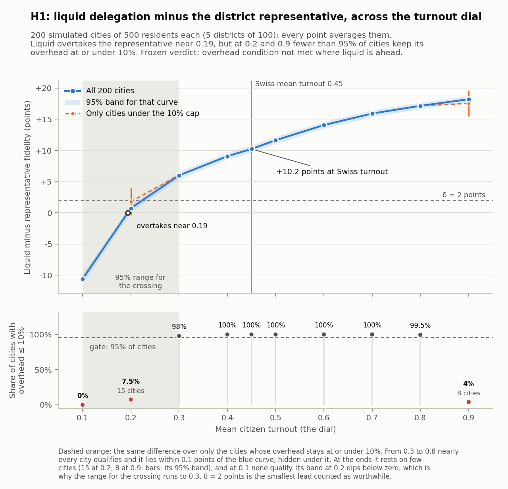
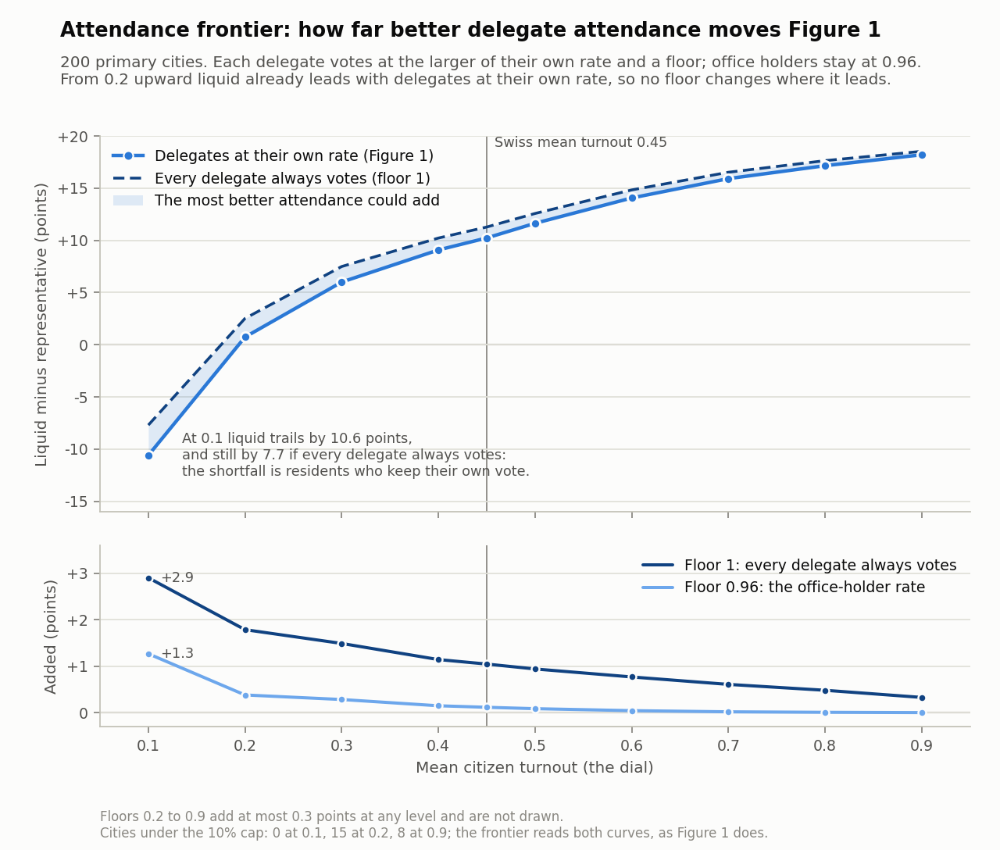
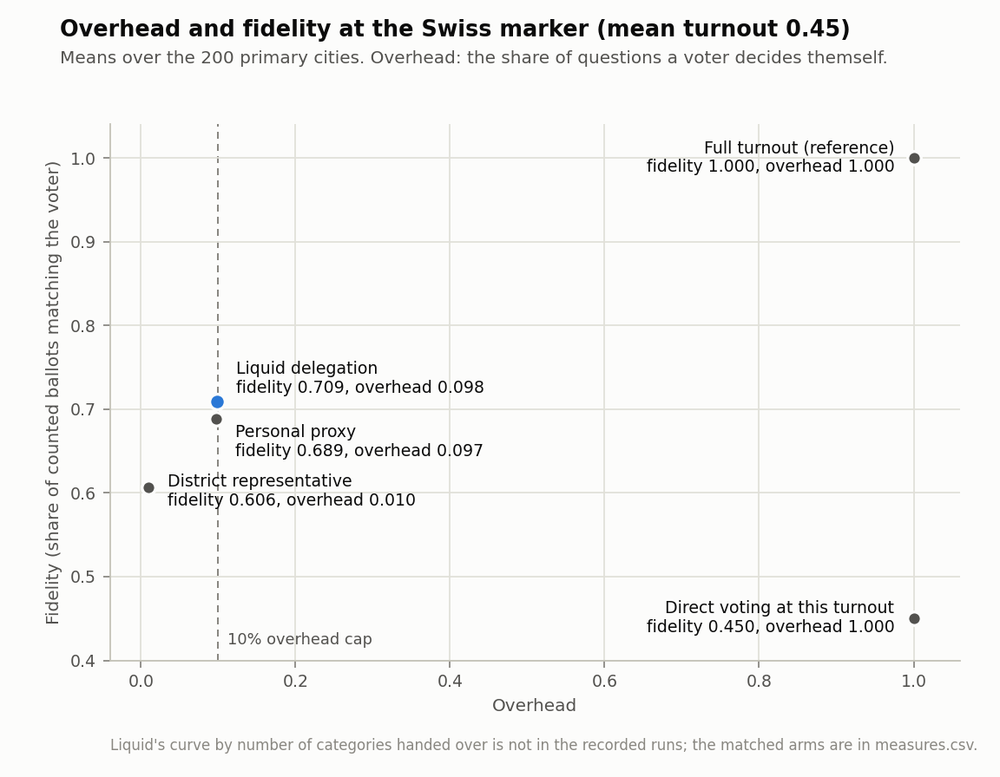
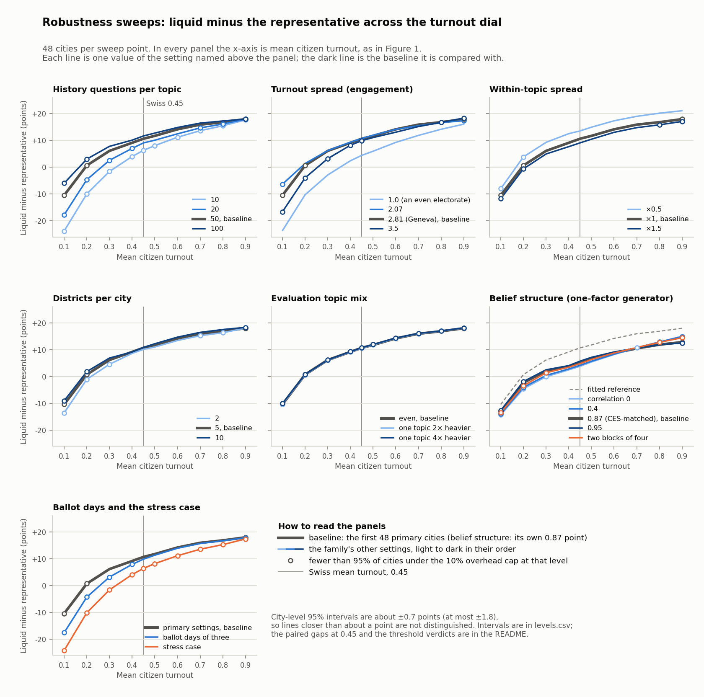

# Liquid-democracy frontier benchmark v1

Does liquid delegation represent voters more faithfully than a district
representative, at comparably low civic overhead, and from what level of
citizen turnout? This benchmark is demo 5's one pre-registered test (H1),
run on synthetic cities whose beliefs are drawn from a model fitted to the
CES 2024 Common Content. It is a simulation, not an election: no
participant data, no live model calls, no real voters.

The protocol, the model description (ODD) and the runner were frozen on
2026-11-19, before any primary or sweep city was simulated. Both runs were
made from the freeze's merge commit
`a50ebcc51ca6df466881db610ea0693f9b48b4d1` on a clean checkout, and
analysed on that same commit. Design:
[`prompts/demo-5-liquid-democracy.md`](../../../prompts/demo-5-liquid-democracy.md),
"Research protocol"; model: [`prompts/demo-5-odd.md`](../../../prompts/demo-5-odd.md).

## Design fixed before this run

- **Cities.** Each city has 5 districts of 100 residents, 8 topics, 50
  history questions and 20 evaluation questions per topic, and 3 candidates
  per district. The **primary** run is 200 pinned cities (seeds
  1,000,000,001 to 1,000,000,200). Each city is simulated at every level
  of the turnout dial, so it keeps its residents across levels.
- **The turnout dial.** Mean citizen turnout runs over 0.1, 0.2, 0.3, 0.4,
  0.45, 0.5, 0.6, 0.7, 0.8 and 0.9. A resident's own rate is
  logistic(location + 2.81·z). The spread 2.81 is calibrated to Geneva's
  register; 0.45 marks the Swiss mean per federal vote and is a reference,
  not an assumption. Office holders, including the representative, vote at
  0.96 (Voteview). Liquid delegates vote at their own rate.
- **Arrangements.**
  - *Full turnout*: everyone votes. It is the reference: fidelity 1,
    overhead 1.
  - *Direct voting* at the dial's turnout.
  - *District representative*: elected by plurality on platform.
  - *Personal proxy*: one city-wide delegate per voter.
  - *Liquid delegation*: one delegate per topic, chosen from public vote
    history.
  - Three matched three-candidate arms, which separate the steps between
    them.

  Liquid and the proxy keep a category unless the best candidate's
  agreement clears an acceptance level. That level is set per city from
  history-period overhead only, so that mean overhead is at most 10%.
- **Measures.**
  - *Fidelity*: the share of a voter's evaluation questions on which the
    counted ballot matches their sincere choice.
  - *Overhead*: the share of questions they decide themself.
- **H1 and its verdict.** H1 is the turnout threshold: the lowest level
  from which liquid's fidelity is strictly above the representative's at
  every higher level.
  - **Two curves.** The threshold is read on the all-city curve and on the
    cities meeting the 10% cap, and the later of the two is taken.
  - **The overhead gate.** At least 95% of cities must meet the cap at
    every level where liquid is claimed ahead. Otherwise the verdict is
    *overhead condition not met*.
  - **Confidence.** A nominal 95% confidence set comes from one
    simultaneous bootstrap-t band over both curves (2,000 city resamples,
    seed 20261118).
  - **Per level.** Each level also gets a direction verdict and a size
    verdict against δ = 0.02.
- **Sweeps.**
  - **Points.** 19 declared points, 48 cities each, every one at every
    level. Each changes one family from the primary settings, except the
    stress case.
  - **Comparison.** Each point is compared with its declared baseline by
    a paired gap at the same seed positions:
    - fitted points against the primary's first 48 cities, the *fitted
      reference*;
    - one-factor (structural) points against the structural 0.87 point;
    - that point against the fitted reference.

## Reproduce

From the repository root, with the project's Python 3.11 environment:

```bash
python -m eval.delegation_frontier verify
```

**The city records are not in the repository.** The two
`*_cities.jsonl.gz` files hold every recorded city (about 7 MB), so this
directory's `.gitignore` keeps them local. `metadata.json` still records
their hashes, so any regenerated copy is checked byte for byte.

- **Without the city records,** `verify` checks every committed file
  against its hash. It also checks that both reports are the frozen runs'
  own analyses.
- **With them,** it also rebuilds the CSV summaries byte for byte. Then it
  re-reads every verdict from the cities with the current runner and
  protocol, in about 30 seconds. Any difference from the published reports
  is an error.

To redraw the figures, which need only the CSVs:

```bash
python -m eval.plot_delegation_frontier
```

To regenerate the city records, run the simulation from the freeze commit:
`python -m scripts.run_liquid_benchmark primary`, then `sweeps`. That takes
about 1 and 5 hours on 14 workers. Then publish:

```bash
python -m eval.delegation_frontier publish
```

`publish` refuses a run that is not from the freeze commit, not clean,
incomplete, or analysed on code other than its own. From the frozen runs
it writes the city records and every other file byte for byte as
published.

## Files

| File | Contents |
|---|---|
| `primary_cities.jsonl.gz`, `sweeps_cities.jsonl.gz` | Not committed (see "Reproduce"); hashes in `metadata.json`. Every recorded city exactly as the runner wrote it, one per line: per level, the signed match counts, cap flags, calibration, attribution, every arrangement's measures, and (primary) the frontier counts |
| `primary_report.json.gz`, `sweeps_report.json.gz` | The runner's own analyses, byte for byte |
| `manifest.json` | Both run manifests: commit, clean state, beliefs-file hash, frozen protocol constants, sweep definitions, Python/NumPy/SciPy |
| `thresholds.csv` | One row per point: verdict, status, bracket, interpolation, confidence set, gate, band critical value, baseline |
| `levels.csv` | Point × level: cap share, H1 on both curves with t-intervals and the simultaneous band, per-level verdicts, specialisation, gap to baseline |
| `frontier.csv` | Primary, level × attendance floor: the difference with its t-interval, and the frontier status |
| `decomposition.csv` | Point × level: every declared contrast and the kept/resolved attribution |
| `measures.csv` | Point × level × arrangement: every measure, averaged over cities |
| `metadata.json`, `figures.json` | Hashes of every file above and of the figures, the generating sources and environments |
| `figure1_threshold.png`, `figure2_frontier.png`, `overhead_fidelity_plane.png`, `sweeps.png` | The figures below |

The simultaneous band is not stored in the reports, only its critical
value. `levels.csv` recomputes it with the protocol's own arithmetic, and
the builder checks that it gives the confidence set each report recorded.

## Results

### Reading the figures

- **What a city is.** A city is one run of the whole experiment.
  - It has 500 synthetic residents in five districts of 100, and eight
    topics.
  - Each topic has 50 past questions, whose votes form the public record
    people choose delegates from, and 20 later questions on which every
    arrangement is scored.
  - Residents' beliefs are drawn from the model fitted to the CES survey,
    and their turnout follows the dial.

  The primary run has 200 cities that differ only in their random seed.
  Each is run at every turnout level with the same residents. Every number
  below is an average over cities, and the spread between cities sets the
  intervals and bands.
- **Two curves.** "All cities" averages every city. "Cities under the
  cap" averages only the cities where liquid's overhead (the share of
  questions people decide themselves) stayed at or under 10%.
  - From 0.3 to 0.8 nearly every city qualifies, and the two curves
    coincide.
  - At 0.2 only 15 cities qualify, at 0.9 only 8, and at 0.1 none. That
    curve is thin or missing exactly where the overhead gate fails.

  H1 reads both curves and takes the later crossing.

### H1 under the frozen rules: not established



**The frozen verdict is "overhead condition not met where liquid is
ahead".**

- **The crossing.** Liquid's fidelity rises above the representative's
  between turnout 0.1 and 0.2 and stays above it at every higher level.
  Both curves cross once, in that bracket. The all-city curve
  interpolates to 0.194, and the first supported level is 0.2. The
  cap-meeting curve has no city at 0.1, so the frozen reading is the
  bracket. The nominal 95% confidence set is (0.1, 0.3], with band
  critical value 3.36. It is a range of turnout, drawn as the grey region
  in Figure 1:
  - it starts after 0.1 because the whole band lies below zero there;
  - it ends at 0.3, not 0.2, because at 0.2 the band on the 15 cities
    under the cap still reaches below zero (−0.4 to +3.9 points). The
    all-city band alone clears zero from 0.2.
- **Why it is not established.** The gate requires at least 95% of
  cities under the 10% cap at every level from the crossing upward. It
  fails at both ends:

| Turnout | 0.1 | 0.2 | 0.3 | 0.4 | 0.45 | 0.5 | 0.6 | 0.7 | 0.8 | 0.9 |
|---|---|---|---|---|---|---|---|---|---|---|
| Cities under the cap | 0% | 7.5% | 98% | 100% | 100% | 100% | 100% | 100% | 99.5% | 4% |

**Level by level the comparison is clear.** Liquid minus representative
fidelity, in percentage points, with the all-city 95% t-interval:

| Turnout | All cities | Cities under the cap | Per-level verdict |
|---|---|---|---|
| 0.1 | −10.6 [−11.0, −10.2] | none | overhead condition not met |
| 0.2 | +0.7 [+0.4, +1.1] | +1.8 (15 cities) | overhead condition not met |
| 0.3 | +6.0 [+5.7, +6.3] | +6.0 | supported, gain of at least δ |
| 0.4 | +9.1 [+8.8, +9.4] | +9.1 | supported, gain of at least δ |
| 0.45 | +10.2 [+9.9, +10.6] | +10.2 | supported, gain of at least δ |
| 0.5 | +11.6 [+11.3, +12.0] | +11.6 | supported, gain of at least δ |
| 0.6 | +14.1 [+13.7, +14.4] | +14.1 | supported, gain of at least δ |
| 0.7 | +15.9 [+15.6, +16.2] | +15.9 | supported, gain of at least δ |
| 0.8 | +17.2 [+16.9, +17.5] | +17.2 | supported, gain of at least δ |
| 0.9 | +18.2 [+17.9, +18.5] | +17.5 (8 cities) | overhead condition not met |

The representative's fidelity is flat at about 0.606, because office
holders vote at 0.96 whatever the citizens do. Liquid's fidelity rises
with turnout: 0.498 at 0.1, 0.709 at the Swiss marker, 0.790 at 0.9.

What the frozen rules establish is narrower than a threshold. Liquid
leads by at least δ, with the overhead condition met, at every tested
level from 0.3 to 0.8. That is a description of the declared per-level
readings, not the H1 threshold verdict, and it was not the declared
hypothesis.

### Why liquid cannot stay under the cap at the ends of the dial

- **Low turnout: empty records.** A resident with no votes of their own
  in the history period has nothing to choose a delegate by, and keeps
  their own vote. Liquid's mean overhead tracks that share:

  | Turnout | Liquid's overhead | Residents with an empty record |
  |---|---|---|
  | 0.1 | 23.6% | 22.8% |
  | 0.2 | 12.2% | 10.9% |

  The personal proxy has the same floor (12.2% at 0.2), so it does not
  come from topic delegation. The calibration checks every distinct
  acceptance level, and at 0.2 none reaches the cap in 185 of 200 cities.
  Such cities get the level with the lowest overhead and are flagged.
- **High turnout: delegation loops.** Voters on a loop of mutual
  delegations end up deciding themselves. At 0.9, 11.5% of voter-question
  pairs sit on a loop, and liquid's overhead is 11.5%. The loop share
  rises steadily with turnout, from 3.0% at 0.45 to 8.2% at 0.8. Again
  no acceptance level reaches the cap, in 192 of 200 cities. This one is
  specific to topic delegation: the single proxy's loop share at 0.9 is
  7.0%, and it meets the cap in 98.5% of cities.

Both failures are properties of the delegation rules as frozen: keeping a
category without a record, and leaving loops to the resolution rule. They
are not sampling noise. A rule for empty records (a default delegate) or
for loops (a backup delegate) is a design variant outside this test.

### The attendance frontier (Figure 2)



Figure 2 asks how far better delegate attendance could move Figure 1's
result. Its upper panel draws Figure 1's curve beside the same
difference if every delegate always voted; the lower panel shows what
the 0.96 and 1.0 floors add. From 0.2 upward, liquid already leads with
delegates at their own rate. That status holds at every level above, on
both curves.

Raising the floor changes little: the delegates people choose are
frequent voters already. Their attendance when holding someone else's
vote is 0.97 at the Swiss marker and 0.92 at 0.1. A floor of 1.0 adds
1.8 points at 0.2, 1 to 1.5 points at 0.3 to 0.5, and less above. From
0.2 upward the office-holder rate of 0.96 adds at most 0.4.

At 0.1, liquid still trails by 7.7 points even if every delegate always
votes, because the shortfall is residents who keep their own vote. The
frontier does not involve the gate. At 0.2 and 0.9 it rests on the 15
and 8 cities under the cap.

### The overhead-fidelity plane



At the Swiss marker, every arrangement except full turnout and direct
voting sits near zero overhead:

| Arrangement | Overhead | Fidelity |
|---|---|---|
| District representative | 0.010 | 0.606 |
| Personal proxy | 0.097 | 0.689 |
| Liquid delegation | 0.098 | 0.709 |
| Direct voting | 1 | 0.450 |
| Full turnout | 1 | 1 |

Direct voting at 0.45 agrees with full turnout on 97.4% of question
outcomes, more than liquid's 85.3% or the representative's 82.2%. In this
model a resident's turnout is drawn independently of their opinions, so
abstention barely moves outcomes. Fidelity, by contrast, counts each
abstention as a ballot that does not represent the voter.

The design called for liquid's own curve on this plane, traced by
handing over zero, one, two and more categories. That is not part of the
recorded runs, which hold only the calibrated arrangement at each level.
It is left to the walkthrough rather than added after the freeze.

### Where liquid's lead comes from

At the Swiss marker, the declared chain from the record-elected
representative to liquid splits H1's +10.2 points:

| Step | Contrast | Points [95%] |
|---|---|---|
| Sharing | own one of the three local candidates, election voters only | +0.6 [+0.6, +0.7] |
| Choice by non-voters | non-voters choose their own one too | +1.1 [+1.0, +1.2] |
| City-wide proxy, combined | 499 candidates city-wide, onward delegation, acceptance, own-rate attendance | +7.3 [+7.0, +7.7] |
| Topic specialisation | eight topic delegates instead of one proxy | +2.0 [+1.8, +2.1] |
| Platform against record | the representative is elected on platform, not record (subtracted) | −0.7 [−1.1, −0.4] |

Most of the gain is the city-wide proxy step. That step changes several
things at once, and no matched arm separates them.

The paired attribution splits the same +10.2 by what liquid does with
each pair:
- **Resolved pairs** contribute +11.4. These are the 90% of pairs liquid
  hands to a delegate.
- **Kept pairs** contribute −1.2. Those are residents who keep a category
  and, at 0.45, often do not vote on it.

### Topic specialisation: real, but not shown to be worth δ

Liquid against the single proxy, at matched overhead:

- **Direction.** Liquid is better at every level where the contrast is
  assessable (0.3 to 0.8).
- **Size.** Against Δ = 2 points the size is never established as
  worthwhile:
  - *size unresolved* at 0.4 to 0.5 (+1.97 [+1.82, +2.12] at 0.45);
  - *practically equivalent* at 0.3 and at 0.6 to 0.8.
- **Assessability.** At 0.1, 0.2 and 0.9 the contrast is not assessable,
  because too few cities have both arms under the cap.

### Secondary outcomes

- **Lower tail (A5).** At the Swiss marker, 17.5% of voters have fewer
  than half their questions represented under the district
  representative. Under liquid it is 6.3%, and under the proxy 8.3%. The
  10th-percentile voter's fidelity is 0.451 against 0.585. The two tails
  differ in kind:
  - liquid's voters below one half have no ballot counted on 73% of their
    questions on average;
  - the representative's have a contrary ballot on 54% of theirs, and no
    ballot on 4%.
- **Concentration (no hypothesis).** Liquid concentrates votes more than
  districts do.
  - A district representative decides 20% of every question.
  - Under liquid at 0.45, the largest single delegate decides 28.5% of a
    question's votes on average, and 43.7% on each city's worst question.
  - At 0.2 the figures are 39.6% and 57.4%.

  This is the super-delegate pattern liquid democracy is known for, and
  it grows as turnout falls.
- **Outcome agreement with full turnout** at 0.45 is 85.3% for liquid,
  84.2% for the proxy and 82.2% for the representative.

### Robustness sweeps



Each panel changes one setting and draws liquid minus the
representative across the whole dial, beside the baseline that setting
is compared with. Hollow markers are levels where fewer than 95% of
cities meet the cap.

At the Swiss marker, liquid is ahead at every one of the 19 points. Every
all-city interval is above zero, ranging from +3.8 points (one-factor,
correlation 0) to +13.6 (within-topic spread ×0.5). Fourteen points are
*supported, gain of at least δ* at 0.45.

Five are *overhead condition not met* at that level:
- both uneven evaluation agendas (56% of cities under the cap);
- 10 history questions per topic (21%);
- the stress case (25%);
- engagement spread 3.5 (94%).

Paired gaps to the declared baseline at 0.45, in points:

| Point | Gap [95%] |
|---|---|
| Engagement spread 1.0 (an even electorate) | −6.2 [−6.8, −5.6] |
| One-factor 0.87 against the fitted reference (generator gap) | −5.4 [−6.3, −4.5] |
| 10 history questions per topic | −4.3 [−4.6, −4.0] |
| Stress case | −4.3 [−4.7, −3.9] |
| 20 history questions per topic | −1.6 [−1.8, −1.3] |
| Within-topic spread ×1.5 | −1.5 [−1.8, −1.3] |
| One-factor, correlation 0 (against 0.87) | −1.5 [−1.9, −1.1] |
| One-factor, correlation 0.4 (against 0.87) | −1.1 [−1.5, −0.8] |
| Ballot days of three questions | −0.8 [−1.2, −0.5] |
| Engagement spread 3.5 | −0.7 [−1.1, −0.4] |
| 2 districts | −0.6 [−1.4, +0.3] |
| One-factor, two blocks of four (against 0.87) | −0.5 [−0.9, −0.1] |
| Evaluation mix, one topic 2× | −0.1 [−0.3, +0.1] |
| Evaluation mix, one topic 4× | +0.0 [−0.3, +0.3] |
| Engagement spread 2.07 | +0.1 [−0.2, +0.4] |
| 10 districts | +0.2 [−0.5, +0.8] |
| One-factor, correlation 0.95 (against 0.87) | +0.4 [+0.2, +0.6] |
| 100 history questions per topic | +1.0 [+0.8, +1.3] |
| Within-topic spread ×0.5 | +2.9 [+2.6, +3.2] |

What the gaps say:
- **Engagement.** How unevenly turnout is spread matters most. With an
  even electorate (spread 1.0) there are no habitual voters to delegate
  to: at 0.45 delegates vote on 86% of the questions where they hold
  someone's vote, against 97% in the fitted reference. Liquid's lead at 0.45 drops to +4.4.
- **History.** Liquid's lead grows with the length of the public record.
- **Generator.** The one-factor generator gives liquid about 5 points
  less than the fitted CES model, so the structural sweep says little
  about the fitted population's level. Within it:
  - correlation across topics moves H1 by at most 1.5 points;
  - specialisation did not grow as topics became less correlated: +1.9
    at correlation 0, +2.3 at 0.95. That is the opposite of the
    pre-benchmark expectation, and the ordering was not tested formally.
- **No effect.** District count and an uneven evaluation agenda leave
  fidelity unchanged. The uneven agenda pushes about half the cities just
  over the cap.

### Sweep thresholds, and the frozen band at 48 cities

| Threshold verdict | Points |
|---|---|
| *crosses*, gate holds | engagement spread 1.0: bracket 0.3 to 0.4, interpolated 0.354, set (0.3, 0.4] |
| *overhead condition not met where liquid is ahead* | history 100, 10 districts, within-topic spread ×0.5 and ×1.5, both evaluation-mix points, engagement spread 2.07, one-factor 0.87 and 0.95; and the fitted reference |
| *overhead condition not met at the top of the range* | history 10 and 20, 2 districts, engagement spread 3.5, ballot days of three, one-factor correlation 0, 0.4 and two blocks, the stress case |

Only the even electorate gives a clean crossing. Its liquid lead starts
later and is smaller, but the gate holds at every level. With an even
spread almost no resident has an empty record, and loops stay under the
cap (7.6% of pairs at 0.9).

**At 12 of the 19 points, and for the fitted reference, the frozen
confidence set is unbounded, (−∞, ∞].** The reason is the band's
studentisation rule, not the data alone:
- At 48 cities some levels have only a handful of cities under the cap.
- Bootstrap resamples then often contain zero or one such city.
- The frozen band treats a lone compliant city whose mean moved as an
  infinite deviation, so the critical value becomes infinite.

The 200-city primary has enough cities at each level, and its band is
finite. The rule did what it was declared to do; it does not suit sparse
cap-meeting levels at 48 cities. The sweeps' evidence is therefore in
their curves, per-level intervals and paired gaps, not their threshold
sets. Any change to the band would be a dated, exploratory amendment
reported beside these results, never a replacement for them.

## Limits

- **Simulation, not data.** Beliefs come from a model fitted to one
  national survey and are placed in synthetic five-district cities.
  Turnout follows a calibrated register model. Delegates are chosen only
  from public vote history. Nothing here measures what real voters would
  delegate, or to whom.
- **One delegation design.** The rules are frozen: keep a category
  without a record, leave loops to the resolution rule, and calibrate the
  acceptance level to a 10% overhead cap. Both gate failures come from
  those rules. Backup delegates, default delegates and onward-delegation
  limits are design variants not tested here.
- **Routing is perfect.** Every question reaches the right topic.
  Measured router error is in `eval/benchmarks/delegation_router_v1/`; H1
  under routing error is a declared follow-up.
- **Fidelity is unweighted.** Every question counts the same for every
  voter. Abstention counts against an arrangement, which is why direct
  voting scores its turnout.
- **The threshold is read on a grid.** Interpolations are grid
  approximations, and the confidence set is nominal (see "Sweep
  thresholds" for where it is unbounded).
- **Seeds are fixed.** 200 primary and 48 sweep cities on pinned seeds.
  The intervals are over cities, not over model uncertainty in the fitted
  beliefs.
