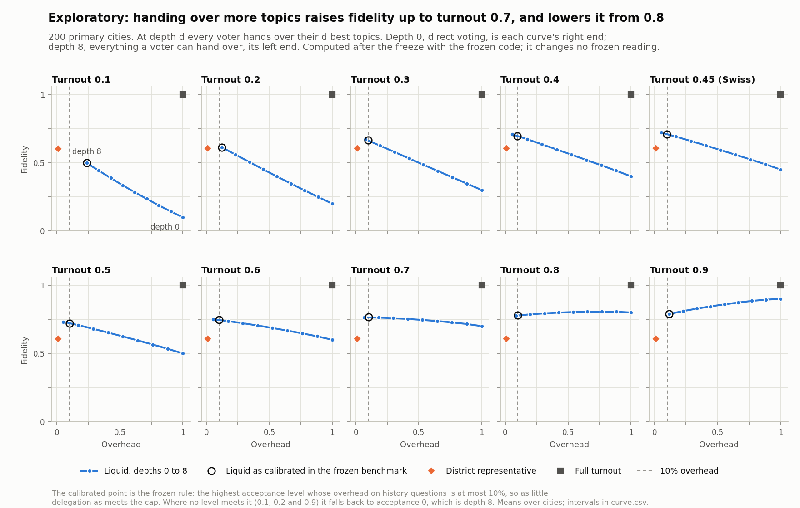

# Liquid handover benchmark v1 (exploratory)

> **Exploratory.** This analysis was declared on 2026-11-19, after the
> frozen benchmark's results had been seen. It is not a hypothesis test,
> and it changes no frozen reading. It is reported beside the frozen
> results, never in place of them.

The frozen benchmark,
[`delegation_frontier_v1`](../delegation_frontier_v1/README.md), holds one
liquid point per turnout level. That point uses the acceptance level
calibrated to a 10% overhead cap. This benchmark traces liquid's whole
curve on the overhead-fidelity plane at every level of the dial, from
direct voting to handing over every topic. It also re-scores the frozen
arrangements with contrary ballots counted against them (the wrong-ballot
table).

It is a simulation: no participant data, no model calls, no real voters.
The run was made from commit `1d92e08e2e553a96f9ffdce2fccfeb3e0fbcd173` on
a clean checkout, with the frozen beliefs file.

The declaration, written before the run, is in
[`prompts/demo-5-liquid-democracy.md`](../../../prompts/demo-5-liquid-democracy.md),
"Exploratory analyses after the freeze". The frozen README left this curve
to the walkthrough. It is computed here instead, declared and labelled.

**Seen before the declaration.** One city (primary position 1) at turnout
0.45 was computed to time the run, and its curve was seen.

## How it was computed

### The handover curve

- **Depth.** At depth d, every voter hands over their d best topics, each
  to that topic's top candidate. Topics are ranked by the top candidate's
  lower bound, and there is no acceptance level.
  - Voters with fewer candidates hand over what they have.
  - A resident with no recorded ballot hands over nothing.
  - Depth 0 is direct voting, and depth 8 is liquid at acceptance 0.
- **Code.** This is the frozen `liquid` arrangement under
  `ChoicePolicy(max_categories=d)` ([`handover.py`](../../../delegation/comparison/handover.py)).
  The frozen choice already takes a voter's topics best first, so the
  choice, routing, loop rule, turnout draws and measures are all
  unchanged.
- **Cities.** The 200 primary cities, on their pinned seeds, at all ten
  levels of the dial. Delegates vote at their own rate (`DIAL_TURNOUT`),
  as in the frozen primary run.
- **Reported.** For each level and depth: the mean over cities of every
  frozen measure, with 95% t-intervals for fidelity and overhead. No
  threshold, gate or verdict is computed.
- **A check.** Depth 0 must reproduce the frozen benchmark's direct voting
  at every level. `verify` compares `curve.csv` with the frozen
  `measures.csv`.

### How the curve differs from the calibrated point

The frozen rule picks the **highest** acceptance level at which overhead on
the *history* questions is at most 10%. That is as little delegation as
meets the cap, and it is chosen without evaluation data.
- The rule is a city-wide cut-off on candidate quality. The curve instead
  fixes how many topics each voter hands over.
- Where no acceptance level meets the cap, the frozen rule falls back to
  its lowest-overhead level, acceptance 0. That is depth 8.

### The wrong-ballot score

Each frozen arrangement is scored at every level as
match − w × contrary:
- **w = 0** is the frozen fidelity. A contrary ballot counts the same as
  an abstention.
- **w = 1** counts a contrary ballot as −1, because on a binary majority it
  cancels a ballot cast the voter's way.

The score comes from the frozen benchmark's published shares, with no new
simulation.

## Reproduce

From the repository root, with the project's Python 3.11 environment:

```bash
python -m eval.delegation_handover verify
```

**The city records are not in the repository.** `cities.jsonl.gz` (about
2 MB) is listed in this directory's `.gitignore`. `metadata.json` keeps
its hash, so a regenerated copy is checked byte for byte.

- **Without the city records,** `verify` checks:
  - every committed file against its hash;
  - that the frozen `measures.csv` this reads is unchanged;
  - the run manifest;
  - that depth 0 reproduces frozen direct voting.
- **With them,** it also rebuilds `curve.csv`, `wrong_ballot.csv` and
  `metadata.json` byte for byte.

To regenerate the city records, check out commit `1d92e08` and run the
two commands below. The run takes about 65 minutes on 14 workers.

```bash
python -m eval.delegation_handover run --workers 14
```

```bash
python -m eval.delegation_handover publish
```

- `run` refuses a checkout with uncommitted changes.
- `publish` refuses a run that does not cover all of these: 200 cities,
  every level and depth, the pinned seeds, and depth 0 equal to direct
  voting in every city.
- Every city is seeded, so a fresh run gives the same city records. Its
  manifest records its own start time, so `manifest.json` differs in that
  field and `metadata.json` in the manifest's hash.

To redraw the figure, which needs only the CSVs:

```bash
python -m eval.plot_delegation_handover
```

## Files

| File | Contents |
|---|---|
| `cities.jsonl.gz` | Not committed (see "Reproduce"); hash in `metadata.json`. One line per city: per level, the seed, mean turnout, pairs, direct-voting matches, and every depth's matches and frozen measures |
| `manifest.json` | The run manifest: commit, clean state, beliefs-file hash, declared constants (date, depths, turnout grid, seeds), Python/NumPy/SciPy |
| `curve.csv` | Level × depth: every frozen measure averaged over cities, with t-intervals for fidelity and overhead |
| `wrong_ballot.csv` | Level × frozen arrangement: match, contrary and abstention shares, and the score at w = 0 and w = 1 |
| `metadata.json`, `figures.json` | Hashes of every file above, of the frozen input and of the figure, the generating sources and environments |
| `handover_curve.png` | The figure below |

## Results

### Reading the figure



- **Each panel** is one turnout level, with overhead on the x axis and
  fidelity on the y axis. Lower overhead is better, and so is higher
  fidelity: up and to the left.
- **The blue line** is liquid at depths 0 to 8. Depth 0, direct voting,
  is always the right end, where everyone answers every question for
  themselves (overhead 1). Each step left is one more topic handed over.
- **The ringed point** is liquid as calibrated in the frozen benchmark.
- **The orange diamond** is the district representative.
- **The grey square** is full turnout (1, 1).
- **The dashed line** is the 10% overhead cap.

All values are means over the 200 cities. The intervals are narrow, at
most ±0.4 points for fidelity and ±0.3 for overhead. They are not drawn,
but they are in `curve.csv`.

### Handing over more topics raises fidelity up to turnout 0.7

| Turnout | Direct voting (depth 0) fidelity | Depth 8 overhead | Depth 8 fidelity | Average change per topic (points) | Highest-fidelity depth |
|---|---|---|---|---|---|
| 0.1 | 0.099 | 0.236 | 0.498 | +5.0 | 8 |
| 0.2 | 0.200 | 0.122 | 0.613 | +5.2 | 8 |
| 0.3 | 0.300 | 0.075 | 0.672 | +4.7 | 8 |
| 0.4 | 0.400 | 0.056 | 0.708 | +3.9 | 8 |
| 0.45 | 0.450 | 0.052 | 0.721 | +3.4 | 8 |
| 0.5 | 0.500 | 0.050 | 0.732 | +2.9 | 8 |
| 0.6 | 0.601 | 0.054 | 0.750 | +1.9 | 8 |
| 0.7 | 0.700 | 0.064 | 0.764 | +0.8 | 8 |
| 0.8 | 0.800 | 0.084 | 0.777 | −0.3 | 2 (0.807) |
| 0.9 | 0.900 | 0.115 | 0.790 | −1.4 | 0 |

- **From 0.1 to 0.7,** fidelity rises with every topic handed over. The
  curve is close to a straight line.
- **At the Swiss marker (0.45),** each topic handed over removes about 12
  points of overhead. That is one eighth of a voter's questions, less the
  2% of residents with no record, who keep everything. Each topic adds 3.0
  to 3.8 points of fidelity, and the later topics add less.
- **At 0.8,** fidelity rises 0.7 points to depth 2, then falls to 0.777 at
  depth 8.
- **At 0.9,** every topic handed over lowers fidelity: from 0.900 at depth
  0 to 0.790 at depth 8.
- **The intervals.** At every level, the 95% intervals at depth 0 and depth
  8 do not overlap.

### Why it turns between 0.7 and 0.8

A handed-over topic is decided by the delegate chain, even on days the
voter would have turned out. Handing a topic over therefore swaps the
voter's own ballot for the delegate's:
- the voter's own ballot represents them when they vote, which happens
  at their turnout rate;
- the delegate's ballot represents them when the delegate attends and
  agrees with them.

At depth 8, 76% to 95% of voter-question pairs are delegated; the share is
lowest at 0.1, where more residents have no record. The fidelity on those
delegated pairs is:

| Turnout | 0.1 | 0.2 | 0.3 | 0.4 | 0.45 | 0.5 | 0.6 | 0.7 | 0.8 | 0.9 |
|---|---|---|---|---|---|---|---|---|---|---|
| Delegated pairs' fidelity, depth 8 | 0.641 | 0.684 | 0.707 | 0.723 | 0.729 | 0.735 | 0.745 | 0.752 | 0.758 | 0.763 |

- **Below 0.7,** the delegated pairs' fidelity is above turnout, so each
  handover helps.
- **From 0.8,** turnout is the higher of the two, so handing over more
  costs fidelity.
- **The handover order.** Topics are handed over best first, so the
  delegated pairs' fidelity is higher at shallow depths: 0.744 at depth 4
  against 0.729 at depth 8, both at 0.45. That is why, at 0.8, a shallow
  handover still helps slightly.

The price is contrary ballots. At 0.45, the share of pairs with no ballot
falls from 55% at depth 0 to 3.5% at depth 8. The share counted against
the voter's sincere view rises from 0 to 24.4%.

### The calibrated point lies on the curve, short of its end

| Turnout | Calibrated overhead | Calibrated fidelity | Curve's fidelity at that overhead | Depth 8 overhead | Depth 8 fidelity |
|---|---|---|---|---|---|
| 0.3 | 0.098 | 0.666 | 0.662 | 0.075 | 0.672 |
| 0.4 | 0.095 | 0.697 | 0.696 | 0.056 | 0.708 |
| 0.45 | 0.098 | 0.709 | 0.709 | 0.052 | 0.721 |
| 0.5 | 0.100 | 0.722 | 0.722 | 0.050 | 0.732 |
| 0.6 | 0.100 | 0.747 | 0.745 | 0.054 | 0.750 |
| 0.7 | 0.100 | 0.766 | 0.764 | 0.064 | 0.764 |
| 0.8 | 0.100 | 0.779 | 0.778 | 0.084 | 0.777 |

"Curve's fidelity at that overhead" is read off the curve by linear
interpolation between neighbouring depths.

**The calibrated point sits on the curve.** From 0.3 to 0.8 it lies within
0.4 points of the curve at the same overhead. At equal overhead, a
city-wide quality cut-off and a fixed count of topics per voter buy about
the same fidelity.

**The frozen rule stops short of the curve's end.** It stops at the cap,
not where fidelity peaks. Going on to depth 8:
- **From 0.3 to 0.5,** depth 8 is better on both measures: 2.3 to 5.0
  points less overhead and 0.6 to 1.2 points more fidelity.
- **At 0.6,** depth 8 has 4.6 points less overhead and about the same
  fidelity (+0.3, within the intervals).
- **At 0.7 and 0.8,** depth 8 has less overhead and 0.2 points less
  fidelity.

This is an observation on evaluation questions, made after the freeze. It
is not a basis for changing the frozen rule, which never looks at
fidelity. A rule tuned on this observation would need its own declared
test.

### No depth meets the cap at the ends of the dial

At 0.1, 0.2 and 0.9, no acceptance level met the cap in most cities, so
the calibrated point already is depth 8, to within 0.0003 on both
measures. Overhead falls with every depth, so depth 8 is the curve's
lowest. Even there it averages 0.236, 0.122 and 0.115, all above the 10%
cap.

On average, then, no handover depth brings liquid under the cap at those
levels. The frozen gate failures at 0.2 and 0.9 do not come from the
acceptance rule stopping early. The frozen README explains the cause:
[why liquid cannot stay under the cap at the ends of the dial](../delegation_frontier_v1/README.md#why-liquid-cannot-stay-under-the-cap-at-the-ends-of-the-dial).

### The wrong-ballot table

| Turnout | Direct voting | Representative, w = 0 | Representative, w = 1 | Proxy, w = 0 | Proxy, w = 1 | Liquid, w = 0 | Liquid, w = 1 |
|---|---|---|---|---|---|---|---|
| 0.1 | 0.099 | 0.604 | 0.248 | 0.497 | 0.261 | 0.498 | 0.265 |
| 0.2 | 0.200 | 0.606 | 0.251 | 0.611 | 0.355 | 0.613 | 0.360 |
| 0.3 | 0.300 | 0.606 | 0.253 | 0.663 | 0.408 | 0.666 | 0.423 |
| 0.4 | 0.400 | 0.606 | 0.253 | 0.678 | 0.439 | 0.697 | 0.465 |
| 0.45 | 0.450 | 0.606 | 0.253 | 0.689 | 0.457 | 0.709 | 0.483 |
| 0.5 | 0.500 | 0.606 | 0.252 | 0.702 | 0.474 | 0.722 | 0.501 |
| 0.6 | 0.601 | 0.606 | 0.254 | 0.729 | 0.509 | 0.747 | 0.533 |
| 0.7 | 0.700 | 0.607 | 0.254 | 0.751 | 0.536 | 0.766 | 0.556 |
| 0.8 | 0.800 | 0.608 | 0.256 | 0.771 | 0.559 | 0.779 | 0.570 |
| 0.9 | 0.900 | 0.608 | 0.256 | 0.783 | 0.573 | 0.790 | 0.584 |

Full turnout scores 1 under both weights.

- **Direct voting** never casts a contrary ballot, so its score is the
  same under both weights.
- **The representative** casts a contrary ballot on about 35% of pairs at
  every level, so at w = 1 it scores about 0.25 everywhere:
  - below direct voting from 0.3 up;
  - below liquid and the proxy at every level, including 0.1, where it
    leads at w = 0.
- **Liquid against direct voting.** At w = 1, liquid stays ahead of direct
  voting up to 0.45 (0.483 against 0.450). It is level at 0.5 (0.501
  against 0.500) and behind from 0.6. At w = 0 it leads up to 0.7.

Counting a contrary ballot as −1 moves liquid's lead over direct voting
about two levels down the dial. It also takes the representative's lead at
the low end of the dial away. These are comparisons of means, without
intervals. The frozen H1 verdict is read at w = 0 and is unchanged.

## Limits

- **Exploratory.** This was declared after the frozen results had been
  seen, and one city's curve was seen before the declaration. The
  findings describe these simulated cities. They are not tested
  hypotheses.
- **The frozen model's limits apply.** Beliefs are simulated, routing is
  perfect and fidelity is unweighted; see the
  [frozen README's limits](../delegation_frontier_v1/README.md#limits).
- **One handover order, one depth for everyone.** Topics are handed over
  in the order of the top candidate's lower bound, and every voter uses
  the same depth. Real voters would hand over different numbers of topics,
  in their own order.
- **Unpaired intervals.** The t-intervals are per depth, over cities. No
  paired contrast was declared, so differences under about 0.4 points
  are not separated from noise here.
- **Interpolated readings.** The curve's fidelity at the calibrated
  overhead is a linear reading between neighbouring depths.
- **The wrong-ballot score covers the frozen arrangements only.** It was
  declared for them, and it uses means without intervals. `curve.csv`
  holds the contrary share, so the score could be applied to the curve.
  That was not declared and is not reported.
